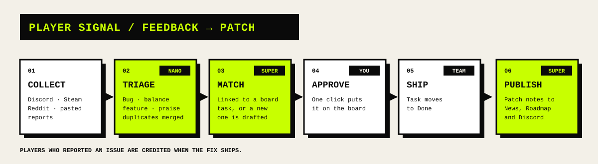
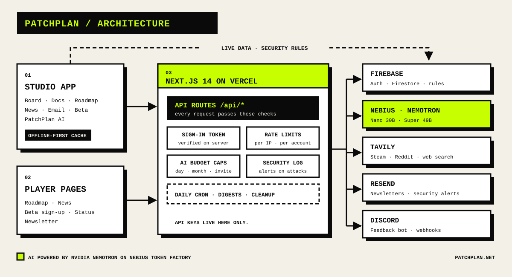

<div align="center">



# PatchPlan

**The production hub for indie game studios: plan the game, hear your players, ship the patch.**

[Live app](https://patchplan.net) · [Changelog](https://patchplan.net/changelog) · [Status](https://patchplan.net/status) · [Docs](docs)


</div>

---

## Why PatchPlan

Small studios juggle a task board, a design doc, a Discord server, Steam reviews, a newsletter tool and a devlog. PatchPlan puts all of it in one place and uses AI to close the loop: **player feedback becomes a task, the task ships, and the patch notes write themselves.**

## Features

| | |
| --- | --- |
| **Production board** | Art, Code, Audio, Design and Bug tasks moving through your pipeline, with Discord alerts. |
| **Design docs** | Living GDDs with rich text and an infinite canvas for level layouts. |
| **Roadmap & News** | A public roadmap and devlog / patch-notes page for players. |
| **Beta testers** | A shareable beta page; bug reports with screenshots become tasks in one click. |
| **Email** | Player sign-ups, newsletters and automatic weekly or daily updates. |
| **Creator network** | Track streamers, YouTubers and press by platform and tier. |
| **PatchPlan AI** | Player Signal, Search Everything and Build Anything (below). |
| **Studios** | Shared workspaces with join codes, a command palette (`Ctrl K`) and full data export. |

## PatchPlan AI

Powered by **NVIDIA Nemotron** models on **Nebius Token Factory**.

| Feature | What it does | Model |
| --- | --- | --- |
| **Player Signal** | Collects feedback from Discord, Steam and Reddit, sorts and de-duplicates it, and links it to board tasks | Nemotron 3 Nano 30B + Super 120B |
| **Patch notes** | Turns shipped tasks into player-facing notes and credits the players who reported them | Nemotron 3 Super 120B |
| **Search Everything** | One question across tasks, docs, news, roadmap and contacts | Nemotron 3 Nano 30B |
| **Build Anything** | Describe a tool ("localization tracker") and get a working table, board or card view | Nemotron 3 Super 120B |



## Architecture



- **Every secret stays on the server.** AI, email and search keys are only read inside `src/app/api/*`.
- **Live data, offline-first.** The browser reads Firestore directly through security rules, with a persistent cache and shared listeners.
- **Guarded AI.** Each request needs a verified sign-in, passes per-IP and per-account rate limits, and draws from a shared daily and monthly budget.
- **Monitored.** Suspicious activity is logged and admins are alerted by email.

## Tech stack

| Layer | Tools |
| --- | --- |
| App | Next.js 14 (App Router), React 18, TypeScript, Tailwind CSS |
| Data & auth | Firebase Auth, Cloud Firestore, Firebase Admin |
| AI | NVIDIA Nemotron on Nebius Token Factory, Tavily search |
| Email | Resend |
| Editors | Tiptap, tldraw |
| Hosting | Vercel (with Vercel Cron) |

## Getting started

**Prerequisites:** Node.js 20+, a Firebase project, and optionally Nebius, Tavily and Resend accounts.

```bash
git clone https://github.com/reyan36/PatchPlan.git
cd PatchPlan
npm install
cp .env.example .env.local   # fill in your keys
npm run dev
```

Open [localhost:3000](http://localhost:3000). Publish [`firestore.rules`](firestore.rules) and [`firestore.indexes.json`](firestore.indexes.json) to your Firebase project before signing in.

### Configuration

All variables are documented in [`.env.example`](.env.example). The essentials:

| Variable | Purpose |
| --- | --- |
| `NEXT_PUBLIC_FIREBASE_*` | Firebase web app config |
| `FIREBASE_SERVICE_ACCOUNT` | Firebase Admin, for server routes and scheduled digests |
| `NEBIUS_API_KEY` | Runs PatchPlan AI |
| `TAVILY_API_KEY` | Optional: Steam and Reddit feedback search |
| `RESEND_API_KEY` | Optional: email sending |
| `AI_ALLOWED_EMAILS` | Accounts allowed to use AI (`*` for everyone) |
| `AI_DISABLED` | Set to `true` to pause all AI instantly |

### Scripts

| Command | Description |
| --- | --- |
| `npm run dev` | Start the development server |
| `npm run build` | Sync the changelog and build for production |
| `npm run start` | Serve the production build |
| `npm run lint` | Lint the project |

## Project structure

```text
src/
├─ app/            Pages and API routes (src/app/api/*)
├─ features/       Feature modules: board, ai, email, beta, ideas…
├─ components/     Shared layout and UI
└─ lib/            Firebase, AI, security, email and data helpers
docs/              Guides for AI, email, security, beta and performance
scripts/           Changelog sync and one-off data migrations
```

## Documentation

[AI](docs/AI.md) · [Email](docs/EMAIL.md) · [Security](docs/SECURITY.md) · [Performance](docs/PERFORMANCE.md) · [Beta](docs/BETA.md) · [Maintenance](docs/MAINTENANCE.md)

## Security

Please don't open a public issue for security problems. Email **privacy@patchplan.net** and we'll respond as soon as we can. See [docs/SECURITY.md](docs/SECURITY.md) for how PatchPlan protects data.

## License

© 2026 PatchPlan. All rights reserved.
